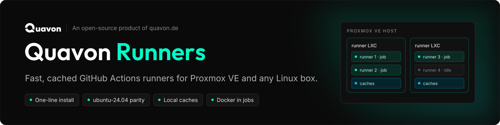
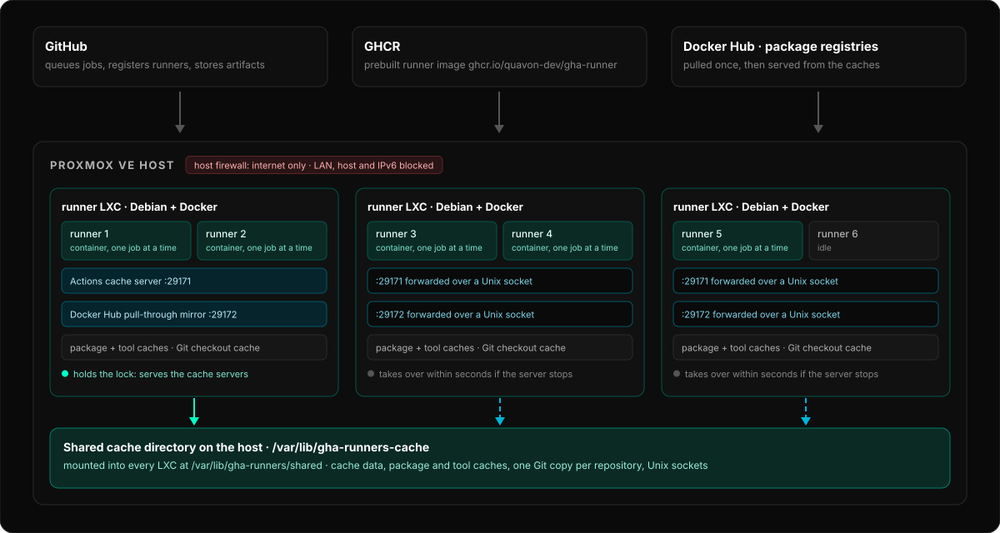

<p align="center">
  
</p>

<p align="center">
  <a href="https://github.com/Quavon-dev/Quavon-Runners/actions/workflows/ci.yml"></a>
  <a href="https://scorecard.dev/viewer/?uri=github.com/Quavon-dev/Quavon-Runners"></a>
  <a href="LICENSE"></a>
</p>

# Quavon Runners

**Quavon Runners** sets up **GitHub Actions self-hosted runners** with one command:
on a Proxmox VE host it creates a Debian LXC with Docker, on any Debian/Ubuntu machine
it installs straight onto the machine. Each runner is a Docker container modeled on
GitHub's hosted `ubuntu-24.04` runner, the image comes prebuilt from GHCR, and the
caches stay local, so CI stays fast on small hosts.

An open-source product of [quavon.de](https://quavon.de).

## Features

| | |
|---|---|
| ⚡ **One-line install** | wizard for repo, org or enterprise runners; [non-interactive](docs/install-proxmox.md#non-interactive-install) too |
| 🐳 **Docker in jobs** | `docker build/run`, `services:`, `container:` jobs, buildx, compose, `services:` ports on `localhost` |
| 🧰 **Hosted-runner parity** | user `runner` with `sudo`, `/opt/hostedtoolcache`, `actions/setup-*`; [three image flavors](docs/images.md) |
| 📦 **Local caches** | `actions/cache` and `type=gha`, registry and apt mirrors, package and tool caches, Git checkout cache, [shared across LXCs](docs/caching.md) |
| 🛡️ **Isolated** | Proxmox firewall keeps jobs off your LAN, host and IPv6; [security model](docs/security.md) |
| 🧹 **Self-cleaning** | workspaces wiped, leftover containers removed, disk reserve so a full disk [never takes the runners down](docs/operations.md#full-disk) |
| 🔁 **Persistent or ephemeral** | keep the container between jobs, or a fresh one for every job |

## How it works

<p align="center">
  
</p>

Every runner LXC runs one container per runner. The caches live next to them. With
several LXCs, one serves the Actions cache and the mirrors and the others
forward to it over a Unix socket in a shared cache directory on the host
([details](docs/caching.md#one-cache-for-several-lxcs)).

## Quick start

**Proxmox VE**, on the host:

```bash
bash -c "$(curl -fsSL https://raw.githubusercontent.com/Quavon-dev/Quavon-Runners/main/install.sh)"
```

**Any Debian or Ubuntu machine** (use a dedicated VM):

```bash
sudo bash -c "$(curl -fsSL https://raw.githubusercontent.com/Quavon-dev/Quavon-Runners/main/install.sh)" _ host
```

Paste the pair code from **Settings → Actions → Runners → New self-hosted runner** when
the wizard asks. Then use it in a workflow:

```yaml
jobs:
  build:
    runs-on: [self-hosted, linux, docker]
```

## Documentation

| | |
|---|---|
| [Install on Proxmox VE](docs/install-proxmox.md) | wizard, runner modes, parallel jobs, sizing, network isolation, non-interactive install |
| [Install on Debian or Ubuntu](docs/install-linux.md) | requirements, other hypervisors and containers, uninstall |
| [Caching](docs/caching.md) | actions cache, Docker Hub mirror, package, tool and Git caches, one cache for several LXCs |
| [Operations](docs/operations.md) | `gha-runners` commands, updates, leftover containers, full disk, image store |
| [Runner images](docs/images.md) | flavors, prebuilt GHCR images, `full-plus` tools, io_uring |
| [Security model](docs/security.md) | what jobs can reach, tokens, shared caches |
| [Benchmarks](docs/benchmarks.md) | measured against GitHub-hosted runners, with caveats |
| [Forking](docs/forking.md) | install from a fork, your own images |
| [Development](docs/development.md) | tests and repository layout |

**Benchmarks:** after the cache fixes, four jobs sharing one 6-core desktop CPU were level
with GitHub-hosted runners on Node, faster on Docker and still slower on Go and Rust; one job
at a time was faster on all four (Go and Rust on runners that had built them before). See the [numbers and caveats](docs/benchmarks.md).

## Security

Jobs can reach the Docker socket, which gives them root inside the LXC (or on the whole
machine without Proxmox). On Proxmox the host firewall keeps them off your LAN, but they
can still use the internet. Don't attach these runners to public repositories that run
workflows from fork pull requests, and only attach repositories that trust each other.
Read the [security model](docs/security.md); report vulnerabilities as described in
[SECURITY.md](SECURITY.md).

## License

[AGPL-3.0](LICENSE). If you run a modified version of this project as a service for
others, you must publish your changes under the same license. Bundled third-party
software keeps its own licenses ([details](docs/images.md#third-party-licenses)).

---

<p align="center">
  <sub>Quavon Runners is an open-source product of <a href="https://quavon.de">quavon.de</a>.</sub>
</p>
