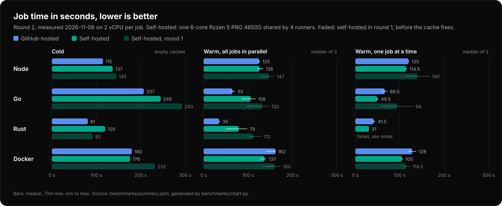

# Benchmarks

GitHub-hosted `ubuntu-latest` against self-hosted runners installed with this repository,
on real open-source builds (Node: axios, Go: caddy, Rust: ripgrep, Docker: distribution).
Full method, raw numbers and step timings: [benchmarks/README.md](../benchmarks/README.md).



**Round 2** ran after the cache fixes (writable Go module cache, shared tool cache, one cache
for all LXCs of the host, registry mirrors for BuildKit builders). Medians in seconds,
speedup = hosted / self-hosted, above 1 means self-hosted is faster:

| Workload | Warm, all jobs in parallel: hosted / self-hosted | Speedup | One job at a time: hosted / self-hosted | Speedup | Round 1 speedup (parallel, one at a time) |
|---|---:|---:|---:|---:|---:|
| Node (axios) | 125 / 126 | 0.99 | 120 / 114.5 | 1.05 | 0.86, 0.81 |
| Go (caddy) | 65 / 106 | 0.61 | 66.5 / 49.5 | 1.34 | 0.50, 0.67 |
| Rust (ripgrep) | 35 / 79 | 0.44 | 41.5 / 31 | 1.34 | 0.32, failed |
| Docker (distribution) | 162 / 137 | 1.18 | 128 / 105 | 1.22 | 0.93, 1.30 |

- **All jobs in parallel** (4 self-hosted runners sharing one 6-core Ryzen 5 PRO 4650G,
  2 vCPU each): level on Node, faster on Docker, still slower on Go (1.6× the hosted time)
  and Rust (2.3×).
- **One job at a time:** faster on all four workloads. The Go and Rust jobs landed on runners
  that had built the project before, which is when their caches help (see below).
- **Against round 1** the self-hosted side got faster in every warm and serial measurement:
  `setup-node` 18 s → 1 s, `setup-go` restores its cache instead of failing and re-uploading
  it, Docker builds 135 s → 109 s.

Why Go and Rust are still slower in parallel:

- **Their build caches only help on the runner that wrote them.** Every runner has its own
  workspace path, `go build` hashes the source directory into its cache keys (without
  `-trimpath`), and `Swatinem/rust-cache` keys on the path of `target/`. On GitHub the path
  is always the same. `go build ./...` took 4 s hosted, 8 s on the runner that built caddy
  before and 26–41 s on the others.
- **CPU.** CPU-bound steps (tests, uncached compiles) took about twice as long with four jobs
  on the 6-core desktop CPU as on GitHub's EPYC/Xeon cores, and were level with one job at a
  time.

What to keep in mind:

- One host, one day, three warm and two serial repetitions per round. Differences below ~15%
  are noise; the hosted side alone moved that much between the rounds.
- The self-hosted side is not fully cold even in the cold round: shared package caches, the
  Git checkout cache and the Docker Hub mirror can't be emptied without hurting other jobs.
- GitHub gives **public** repositories 4 vCPU / 16 GB; these numbers compare against the
  2 vCPU machine of a private repository.
- The host is outside Azure; network location and bandwidth were not measured.

Cold times, step timings, what the logs show for each fix, and round 1 in detail:
[benchmarks/README.md](../benchmarks/README.md).

## Regenerate the chart

After a new round (see [Reproduce](../benchmarks/README.md#reproduce)):

```bash
python3 benchmarks/summarize.py r2=results.json r1=benchmarks/results/2026-11-06.json >benchmarks/summary.json
python3 benchmarks/chart.py
```

`chart.py` reads `benchmarks/summary.json` and writes `docs/assets/benchmark.svg`, with the
round named in `MAIN` as the main bars and `BEFORE` faded. It needs only Python 3. Update
the subtitle in `chart.py` when the hardware or setup changes.
