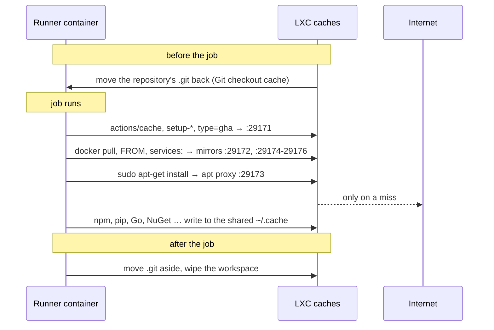
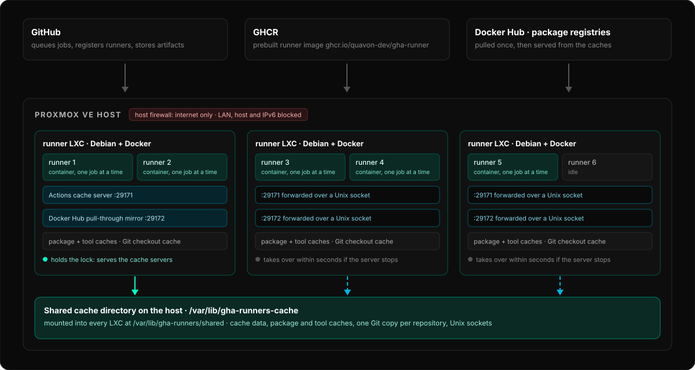

# Caching

These caches live in the LXC. They need no workflow changes. Each cache server is capped
(64 MB RAM, the actions cache 256 MB) and idles at 3-20 MB; together about 75 MB.

| Cache | What it speeds up | Where |
|---|---|---|
| **Actions cache** | `actions/cache`, `setup-node`/`setup-python`/`setup-go`/`setup-java` with `cache:`, BuildKit `cache-from/to: type=gha` | [github-actions-cache-server](https://github.com/falcondev-oss/github-actions-cache-server) on `docker0:29171`, data in `/var/lib/gha-runners/actions-cache` |
| **Docker Hub mirror** | `docker pull`, `services:`, `container:` jobs, `FROM` in builds, also in buildx builders; no Docker Hub rate limits | `registry:3` pull-through cache on `docker0:29172`, data in `/var/lib/gha-runners/mirror-cache` |
| **ghcr.io, quay.io and mcr.microsoft.com mirrors** | `FROM` in buildx builders (`docker/setup-buildx-action`), the prebuilt runner image | `registry:3` pull-through caches on `docker0:29174`, `:29175`, `:29176`, data in `/var/lib/gha-runners/{ghcr,quay,mcr}-cache` |
| **apt proxy** | `sudo apt-get install` in jobs, for `http://` repositories (Ubuntu's own) | nginx on `docker0:29173`, data in `/var/lib/gha-runners/apt-cache` |
| **Git checkout cache** | `actions/checkout` fetches only the commits since the last job of the repository (e.g. 50 KB instead of 15 MB), Git LFS objects included | each runner's `.git` per repository, in `/srv/gha-runners/<runner>/_git` |
| **Package caches** | npm, pip, pnpm, bun, Go modules and build cache, NuGet, anything else under `~/.cache`, even without a cache step | `~/.cache` and `~/.npm` of every runner, shared, in `/var/lib/gha-runners/package-cache` |



- **Actions cache.** Restores come from the LXC's disk instead of GitHub's cloud. The
  server checks every job's token and keeps caches per repository and branch, with the same
  rules as GitHub. It is capped at a fifth of the disk and yields when the disk is 70%
  full (least recently used first). Entries unused for 14 days are removed. The stock
  runner overwrites the cache URL at every job, so the runner image renames that variable
  in `Runner.Worker.dll` (`gha-patch-runner`) at every start and after every job.
  - Only for github.com: GitHub Enterprise Server runners keep using GitHub's cache.
  - `container:` jobs don't get the URL from the runner. Their cache steps skip the cache
    unless the job sets `env: ACTIONS_RESULTS_URL: http://172.17.0.1:29171/`.
  - Artifacts are passed through to GitHub unchanged.
  - The first job after a runner self-update still uses GitHub's cache.
- **Docker Hub mirror.** Blobs are kept for 7 days and checked against Docker Hub. If the
  mirror is down, Docker pulls from Docker Hub directly.
- **Registry mirrors for buildx.** BuildKit builders of the `docker-container` driver (the
  default of `docker/setup-buildx-action`) run their own `buildkitd` and don't use Docker's
  mirror. The runner writes `~/.docker/buildx/buildkitd.default.toml`, which buildx copies
  into every builder it creates without its own `config`/`buildkitd-config`. It points
  `docker.io`, `ghcr.io`, `quay.io` and `mcr.microsoft.com` at the mirrors. Builders
  created before (a job's own `buildx create --config`) pull directly.
  - Mirrored blobs of ghcr.io, quay.io and MCR are kept for 3 days.
  - `docker pull ghcr.io/…` in a job does **not** use the mirrors: Docker's classic image
    store only mirrors Docker Hub. Pull through BuildKit, or by hand from
    `172.17.0.1:29174/<owner>/<image>` (Docker trusts that address over http).
  - `gha-runners build` and `update` pull the prebuilt runner image through the ghcr.io
    mirror and fall back to GHCR directly. With a shared cache, the ~3.6 GB image is
    downloaded once for all LXCs.
  - public.ecr.aws works the same way but is not mirrored: its images are mostly Docker
    Hub copies, and every mirror costs about 20 MB of RAM.
  - **Only public images.** The mirrors have no credentials and never ask a client for
    any, so a job's `docker login` is never sent to them, stored or reused. A private
    image is "not found" in the mirror, and Docker and BuildKit then pull it from the
    registry itself with the job's credentials, as without a mirror.
- **apt proxy.** Jobs that run `sudo apt-get` in the runner go through a small nginx
  proxy. It keeps packages (`.deb`) and the `by-hash` package indexes, which never
  change, for 14 days; the release files always come fresh from the repository.
  `https://` repositories (Docker, Microsoft, most third-party ones) pass by it
  without caching. Before each repository, apt asks `gha-apt-proxy` (apt's
  `Proxy-Auto-Detect`), which only names the proxy if it answers, so apt never
  breaks when it's down. `container:` jobs use their own image and don't use it.
- **Git checkout cache.** After a job, the repository's `.git` is moved aside (a rename,
  no copy). Before the next job of that repository on the runner, it's moved back into the
  empty workspace, keeping only objects, refs and `HEAD` with a fresh config, so hooks and
  settings of earlier jobs never run. `actions/checkout` then cleans, resets and fetches
  the difference. If anything doesn't fit, checkout deletes it and clones as usual. Works
  in ephemeral mode too. A job that doesn't use `actions/checkout` finds only `.git` in its
  workspace: run `git clone` into a subdirectory there, or turn the cache off.
- **Package caches.** Every runner in the LXC reads and writes the same caches. In ephemeral
  mode they survive the container too, so a fresh container doesn't start empty.
  `GOMODCACHE`, `NUGET_PACKAGES`, `npm_config_store_dir` and `BUN_INSTALL_CACHE_DIR`
  point into `~/.cache`. The tool cache (`/opt/hostedtoolcache`, where `setup-node`,
  `setup-go`, `setup-python` & co. put the versions they download) is shared too, so each
  version is downloaded once for all runners. `GOFLAGS=-modcacherw` keeps Go's module
  cache writable, so `setup-go` can restore its cache over it.
- **Paths per runner.** Every runner has its own workspace path (it contains the runner
  name), because `container:` jobs need the same path on the LXC. Caches whose paths
  include the workspace, such as the `target` directory of `Swatinem/rust-cache`, are
  therefore only restored on the runner that saved them.

All cache servers listen only on the `docker0` address (`172.17.0.1`), on the host
network: runners, job containers and buildx builders reach them, the LAN doesn't (on
Proxmox the host firewall drops inbound traffic to the LXC anyway).

From 80% disk all caches are dropped together with unused images (see [Full disk](operations.md#full-disk)).
They refill on the next jobs. `gha-runners doctor` shows their state and size.

The caches are shared by every job on the LXC, across repositories. Only attach
repositories that trust each other (see [Security](security.md)).

## One cache for several LXCs



With the `separate` layout the installer gives all its LXCs one shared cache. For LXCs that
already exist, run on the Proxmox host:

```bash
bash -c "$(curl -fsSL https://raw.githubusercontent.com/Quavon-dev/Quavon-Runners/main/install.sh)" _ share-cache 124 128 129 130
```

- The host keeps the caches in `/var/lib/gha-runners-cache`: a ZFS dataset with a quota
  when the LXCs are on ZFS, otherwise a directory, if its disk has room. It's mounted
  into every LXC at `/var/lib/gha-runners/shared` (not included in backups).
- The size is 30 GB; `SHARED_CACHE_GB=60` in front of the command changes it.
- From 80% of it, the package and Git caches, the apt cache and the mirrors are cleared (by
  the LXC serving them for the last two); the actions cache stays within 40% by itself.
- Each cache server runs in exactly one LXC, the first that takes its lock. The others
  forward their ports to it through a Unix socket in the shared directory, so no
  firewall rule or fixed IP is needed. If that LXC stops, another one takes over within
  seconds, with the same data. Each cache server can run in a different LXC.
- The package caches are shared directly. The Git cache keeps each runner's own copy and
  puts one copy per repository into the shared directory once a day, so a runner
  without its own copy doesn't start from scratch.
- All LXCs need the same `docker0` address (Docker's default `172.17.0.1`).
- Each LXC is done in turn: its runners stop once their job is finished, the mount is
  added (a restart only if Proxmox can't add it to the running LXC), then it is updated.
  The others keep taking jobs. The command stops at the first LXC that doesn't come back.

## Turning caches off

Turn a cache off in `/etc/gha-runners/config.env`, then run `bash /opt/quavon-docker-runners/lxc/setup.sh files`
(the runners restart):

```text
LOCAL_ACTIONS_CACHE=0
DOCKER_HUB_MIRROR=0
GHCR_MIRROR=0
QUAY_MIRROR=0
MCR_MIRROR=0
APT_PROXY=0
GIT_CHECKOUT_CACHE=0
SHARED_PACKAGE_CACHE=0
```
